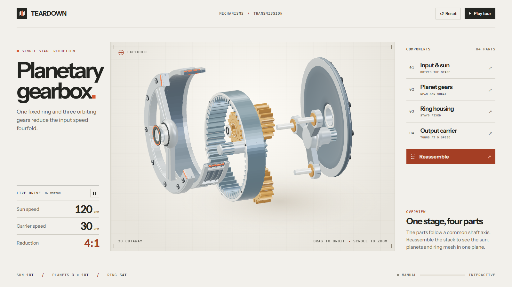

# Planetary Gearbox Teardown

交互式行星齿轮箱剖面。旋转模型、逐件拆解或播放自动导览，观察固定齿圈怎样让行星架以输入轴四分之一的速度转动。



## 本地运行

安装 Node.js 20 或更高版本后，在仓库根目录执行以下命令。

```sh
npm ci
npm run build
```

在支持 WebGL 2 的浏览器中打开 `dist/planetary-gearbox.html`。生成的 HTML 可离线使用。

- **复用页面风格** · 复制[中文提示词模板](docs/prompt-template.md)，替换对象、部件和数据。内附手摇磨豆机示例。
- **检查交互** · 运行 `npm run check`。使用已安装的 Chrome，或先运行 `npx playwright install chromium`。
- **导出短片** · 将 Python 3、FFmpeg 和 FFprobe 加入 PATH 后运行 `npm run film`。短片与交互页共用模型和导览时间轴。

工作流参考 Teardown。齿轮运动关系和齿圈几何分别参考 MathWorks 和 KHK。[Teardown](https://github.com/elvarofficial/teardown) · [MathWorks](https://www.mathworks.com/help/sdl/ref/planetarygear.html) · [KHK](https://khkgears.net/pdf/internal-tech.pdf)

Three.js 的 MIT 许可随 HTML 打包，字体许可保存在仓库中。[字体许可](fonts/)
